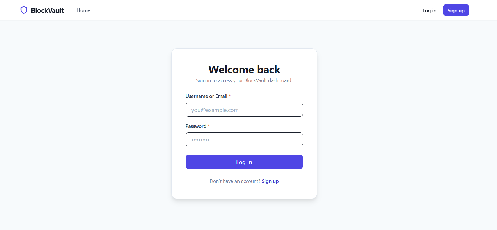
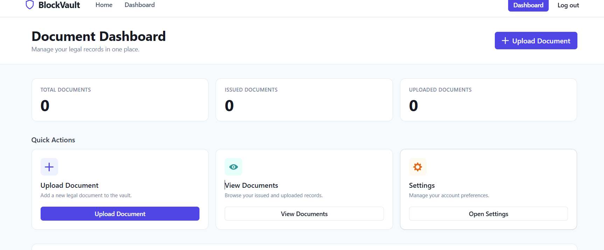
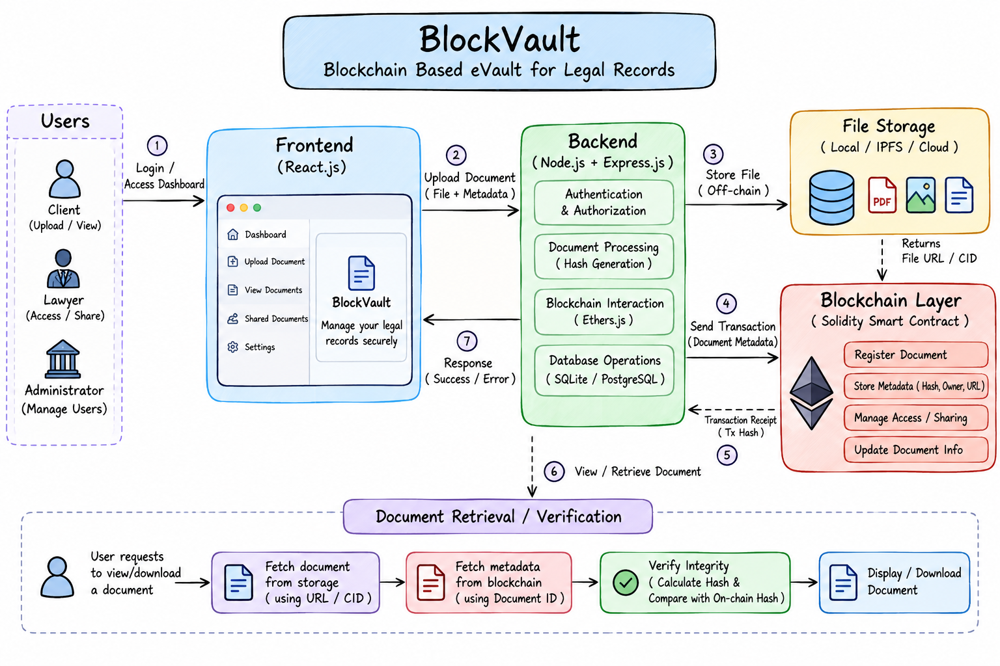

# Blockchain eVault System for Legal Records

A decentralized document management system for legal records built on Ethereum blockchain. It provides secure storage, sharing, and verification of legal documents with role-based access control.

---

## Screenshots

### Login Page


### Dashboard


### Workflow


---

## Table of Contents

- [Overview](#overview)
- [Problem Statement](#problem-statement)
- [Solution](#solution)
- [Tech Stack](#tech-stack)
- [Project Structure](#project-structure)
- [Prerequisites](#prerequisites)
- [Blockchain Setup](#blockchain-setup)
- [Configuration](#configuration)
- [Running the Project](#running-the-project)
- [API Reference](#api-reference)
- [Smart Contract](#smart-contract)
- [How It Works](#how-it-works)

---

## Overview

The Blockchain eVault System replaces traditional paper-based legal record management with a transparent, tamper-proof, and decentralized solution. Every document is hashed and stored on the Ethereum blockchain, ensuring integrity and auditability. Access control is enforced at the smart contract level.

---

## Problem Statement

| Problem | Impact |
|---|---|
| Lack of transparency | Disputes over document authenticity |
| No long-term storage | Risk of data loss |
| Server downtimes | Unavailability during critical proceedings |
| Improper authorization | Unauthorized access to sensitive records |
| Simple login system | Weak security |
| Complex sharing process | Delays in court proceedings |

---

## Solution

- **Dispute Resolution** — Transparent platform for sharing evidence between parties
- **Role-Based Authorization** — Permissions for lawyers, judges, and users enforced on-chain
- **Third-Party Integration** — REST API with full documentation
- **Document Sharing** — Entity-based sharing using blockchain wallet addresses
- **Fast Court Proceedings** — Efficient role management and document verification
- **KYC as a Service** — Secure user verification without exposing sensitive data

---

## Tech Stack

| Layer | Technology |
|---|---|
| Smart Contract | Solidity `^0.8.0` |
| Blockchain Interaction | Ethers.js `v6` |
| Backend | Node.js, Express.js |
| Database | SQLite via Sequelize ORM |
| File Handling | Multer |
| Authentication | JWT, bcrypt |
| Frontend | React 18, Vite |
| UI Library | Chakra UI |
| Local Blockchain | Ganache CLI |

---

## Project Structure

```
blockdoc/
├── app/
│   ├── contract/
│   │   ├── engine.sol        # Solidity smart contract
│   │   ├── engine.json       # Contract ABI
│   │   └── index.js          # Ethers.js contract client
│   ├── database/
│   │   ├── models/
│   │   │   ├── User.js       # User model
│   │   │   └── Document.js   # Document model
│   │   └── index.js          # Sequelize setup
│   ├── lib/
│   │   └── fileHasher.js     # SHA256 file hashing
│   ├── routes/
│   │   └── api/
│   │       ├── middlewares/  # Auth & validation middlewares
│   │       ├── login.js      # Signup & login routes
│   │       ├── document.js   # Document routes
│   │       └── index.js
│   └── config.js             # TOML config loader
├── web/                      # React frontend (Vite)
│   └── src/
│       └── components/       # All UI components
├── assets/                   # Project screenshots
├── config.toml               # App configuration (not committed)
├── server.js                 # Express entry point
└── package.json
```

---

## Prerequisites

Make sure the following are installed:

- [Node.js](https://nodejs.org/) v18+
- [npm](https://www.npmjs.com/) v9+
- [Ganache CLI](https://github.com/trufflesuite/ganache) — local Ethereum blockchain
- [Remix IDE](https://remix.ethereum.org) — for deploying the smart contract

Install Ganache CLI globally:
```bash
npm install -g ganache
```

---

## Blockchain Setup

### Step 1 — Start Ganache

Open a terminal and run:
```bash
ganache
```

Ganache will start a local blockchain at `http://127.0.0.1:8545` and print 10 test accounts with private keys. Copy **Account 0's address and private key**.

```
Available Accounts
==================
(0) 0xYourAddress (1000 ETH)

Private Keys
==================
(0) 0xYourPrivateKey
```

### Step 2 — Deploy the Smart Contract

1. Open [Remix IDE](https://remix.ethereum.org)
2. Create a new file and paste the contents of `app/contract/engine.sol`
3. Go to **Solidity Compiler** tab → compile with version `0.8.0`
4. Go to **Deploy & Run Transactions** tab:
   - Set **Environment** to `Custom - External Http Provider`
   - Enter RPC URL: `http://127.0.0.1:8545`
   - Click **Deploy**
5. Copy the deployed **contract address** from the bottom-left panel

---

## Configuration

Create a `config.toml` file in the project root:

```toml
[jwt]
secret = "your_jwt_secret_change_this"
expires_in = "7d"

[database]
dialect = "sqlite"
storage = "./database.sqlite"
logging = false

[contract]
address = "0xYourDeployedContractAddress"
owner_address = "0xGanacheAccount0Address"
owner_private_key = "0xGanacheAccount0PrivateKey"
rpc_url = "http://127.0.0.1:8545"
```

> `config.toml` is listed in `.gitignore` and should never be committed.

---

## Running the Project

### Install Dependencies

```bash
# Backend
npm install

# Frontend
npm install --prefix web
```

### Start Backend

```bash
npm start
# Server runs on http://localhost:3001
```

For development with auto-reload:
```bash
npm test
# Uses nodemon
```

### Start Frontend

```bash
cd web
npm run dev
# Frontend runs on http://localhost:5173
```

> Make sure Ganache is running before starting the backend.

---

## API Reference

All endpoints are prefixed with `/api`.

### Authentication

| Method | Endpoint | Body Parameters | Response |
|---|---|---|---|
| POST | `/api/login` | `email`, `password` | `{ token }` |
| POST | `/api/signup` | `username`, `name`, `email`, `password` | `200 OK` |

### Document Management

All document endpoints require an `Authorization: Bearer <token>` header.

| Method | Endpoint | Parameters | Response |
|---|---|---|---|
| POST | `/api/doc/upload` | `file` (multipart), `doc_type`, `doc_id`, `owner` (optional username) | `201 Created` |
| GET | `/api/doc/list` | — | `{ issued_docs, uploaded_docs }` |
| GET | `/api/doc/file/:hash` | `:hash` — content hash of document | File download |
| POST | `/api/doc/edit/:hash` | `file` (multipart), `new_doc_type` | `200 OK` |
| POST | `/api/doc/share/:hash` | `username` — recipient's username | `200 OK` |

---

## Smart Contract

The `DocumentRegistry` contract (`engine.sol`) handles all on-chain logic.

### Key Functions

| Function | Access | Description |
|---|---|---|
| `createUser(name, addr)` | Admin only | Registers a new user on-chain |
| `grantRole(addr, role)` | Admin only | Assigns a role and verifies the user |
| `storeDocument(...)` | Any | Stores a document hash on-chain |
| `fetchMyIds()` | Owner | Returns all document hashes for caller |
| `fetchDocumentById(hash)` | Owner/Creator | Returns document metadata |
| `editDocument(hash, ...)` | Owner | Updates document type and hash |
| `shareUserAccess(hash, addr)` | Owner | Grants another user access to a document |

### Roles
- `User` — default role on signup
- `Lawyer` / `Judge` — granted by admin via `grantRole`

---

## How It Works

1. **Signup** — A new Ethereum wallet is auto-generated for each user. The wallet address is registered on the smart contract via `createUser`.
2. **Login** — JWT token is issued containing the user's wallet private key (encrypted in transit).
3. **Upload** — File is hashed (SHA256), stored on disk, and the hash is recorded on-chain via `storeDocument`.
4. **List** — Calls `fetchMyIds` on-chain using the user's wallet, then fetches metadata for each document.
5. **Share** — Calls `shareUserAccess` on-chain, granting the recipient's wallet access to the document hash.
6. **Download** — Looks up the file path by content hash in SQLite and streams the file.

---

## License

MIT — see [LICENSE](./LICENSE)
